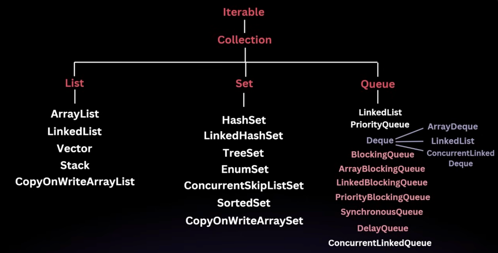

# Collections Framework

## Collection Interface 
1. List - Ordered preservation or collection/ Index-based/ and allows duplicates.
   1. ArrayList 
   2. LinkedList
   3. Vector
   4. Stack
   5. CopyOnWriteArrayList
2. Set
3. Queue
4. Dequeue
5. Map
   1. Key->value pair (Roll Number/ Dictionary) -> Unique Key and one value per key

